<!-- 顶部徽章 / 版本号 -->
<p align="center">
  
</p>

<h1 align="center">PBlossom</h1>
<p align="center"><em>Ancient Wisdom, Modern Elegance</em></p>

<p align="center">
  
  
  <a href="https://wjsgzz.github.io/PBlossom/"></a>
  <a href="LICENSE"></a>
</p>

---

<p>
PBlossom 是一款将传统易理逻辑与现代数字化技术相结合的探索工具：梅花易数起卦、大六壬排盘、干支时令查询。
排出的结果可以一键复制，交给 AI 解读，让普通用户也能零门槛接触千年智慧。
</p>

<p align="center">
  <a href="#开始使用">开始使用</a> &nbsp;|&nbsp;
  <a href="#功能简介">功能简介</a> &nbsp;|&nbsp;
  <a href="#界面展示">界面展示</a> &nbsp;|&nbsp;
  <a href="#本地运行与开发">本地运行与开发</a> &nbsp;|&nbsp;
  <a href="#名称来源">名称来源</a> &nbsp;|&nbsp;
  <a href="#logo设计">Logo设计</a> &nbsp;|&nbsp;
  <a href="#温馨提示">温馨提示</a> &nbsp;|&nbsp;
  <a href="#许可">许可</a>
</p>

## 开始使用
- **网页**：https://wjsgzz.github.io/PBlossom/ （电脑、手机浏览器都能用）
- **小程序**：微信搜索 **PBlossom**

网页版与小程序是同一套代码：排盘算法、界面和导出图片都与小程序一致。记录只保存在你自己的浏览器里，不会上传。

## 功能简介
- **新占** (Divination)：梅花易数起卦，自动推演本卦、变卦、互卦，以及它们与年月日时干支的生克关系。默认按当前时间起卦，也可在高级设置中指定日期和时间，复现历史卦例。
- **六壬** (Liuren)：大六壬排盘，支持真太阳时校正，给出天地盘、四课、三传与课体。
- **往昔** (History)：梅花与六壬的记录统一保存、筛选，手机上长按、电脑上右键点按可删除；网页版可从文件导入卦例，电脑上也能直接把 .txt 拖进网页。
- **时令** (Seasons)：任选日期时间，查看四柱干支、藏干、节气与月历，支持真太阳时。
- **常见问题** (FAQ)：使用说明、AI 解读提示词，以及主题色、五行标记等外观设置；网页版还能选择深色模式（跟随系统 / 浅色 / 深色）。
- **导出与分享**：结果和时令都能导出为图片；网页版还可以复制一条链接，对方打开就能看到同一卦。

## 界面展示
### 网页版
电脑上是左侧图标栏加两栏排版，卡片用液态玻璃质感；手机浏览器里与小程序一样用底部导航。

<div align="center">
  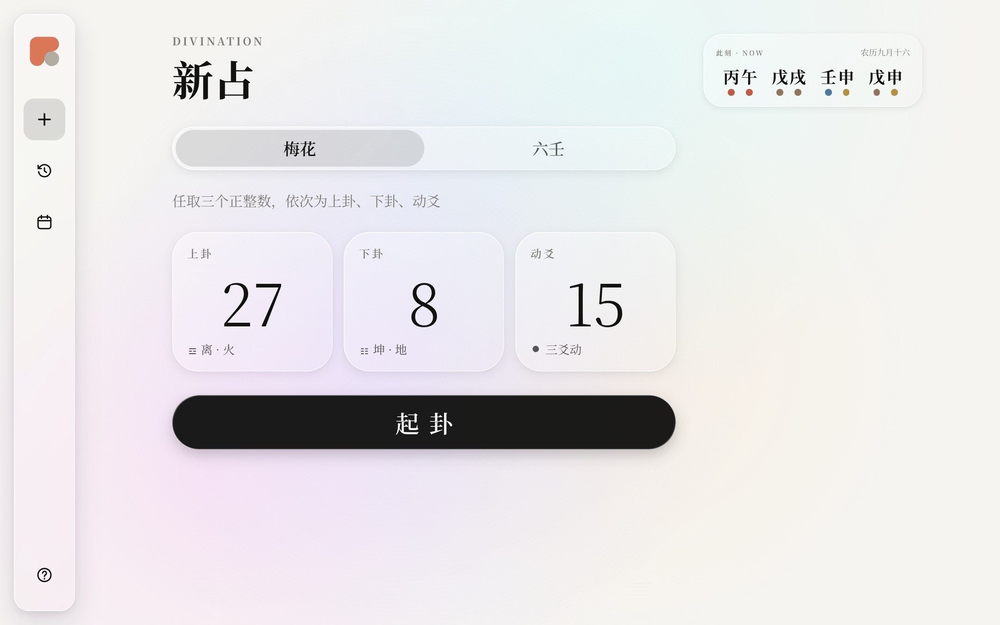
  <p><strong>新占</strong></p>
<table>
  <tr>
    <td align="center">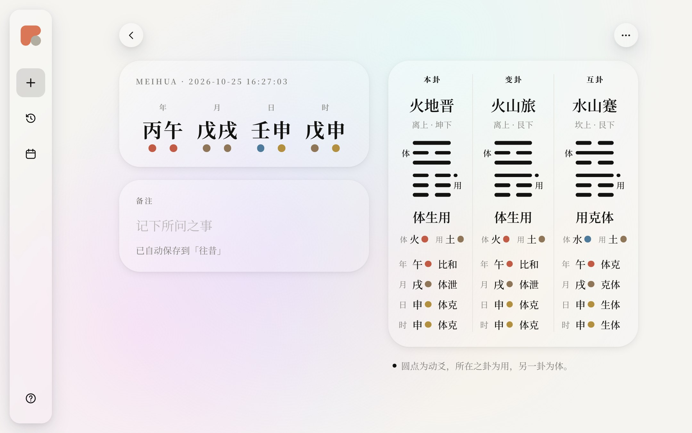</td>
    <td align="center">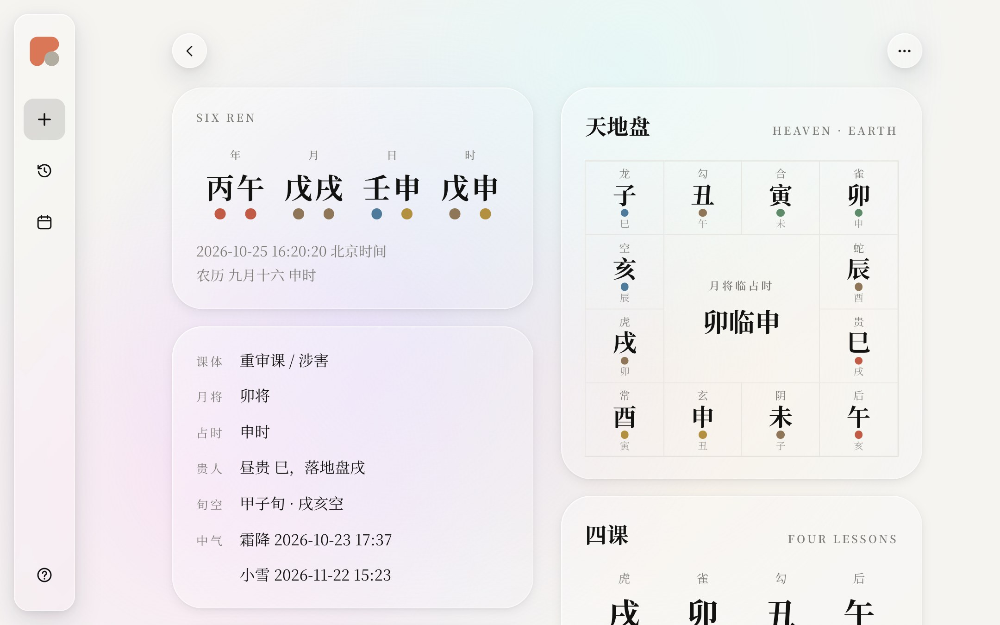</td>
  </tr>
  <tr>
    <td align="center"><strong>梅花结果</strong></td>
    <td align="center"><strong>六壬结果</strong></td>
  </tr>
  <tr>
    <td align="center">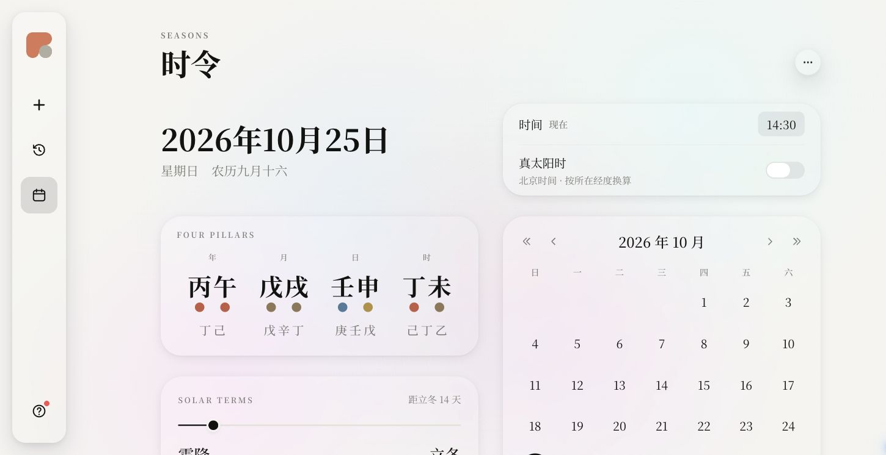</td>
    <td align="center">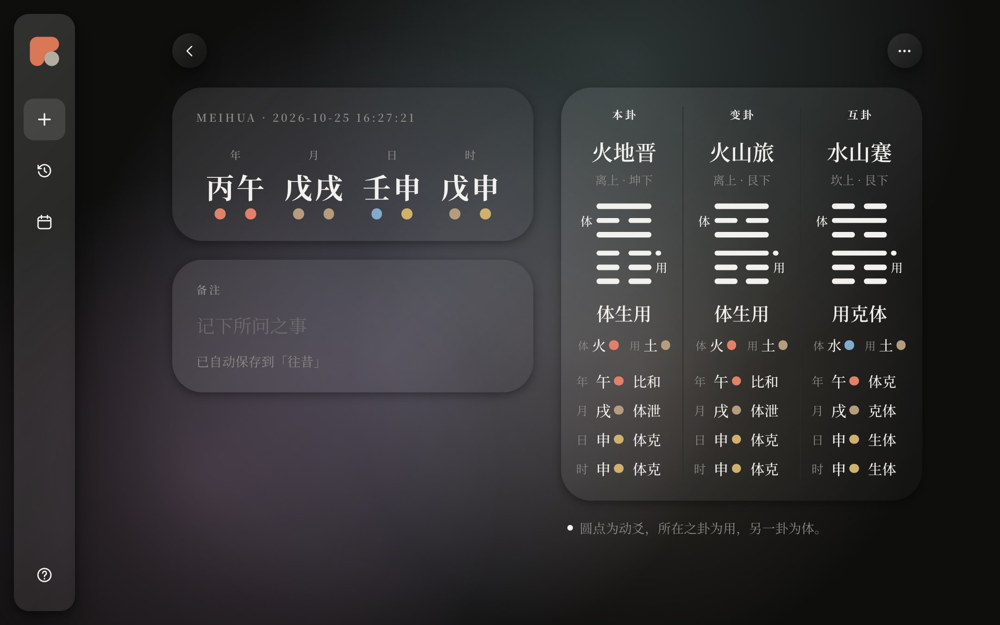</td>
  </tr>
  <tr>
    <td align="center"><strong>时令</strong></td>
    <td align="center"><strong>深色模式</strong></td>
  </tr>
</table>
</div>

### 导出图片
结果和时令都能一键导出成图片，直接发给朋友或交给 AI 解读；备注、问事也会一起排进图里。

<div align="center">
<table>
  <tr>
    <td align="center" valign="top">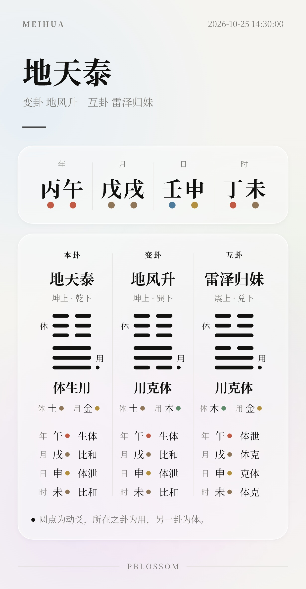</td>
    <td align="center" valign="top">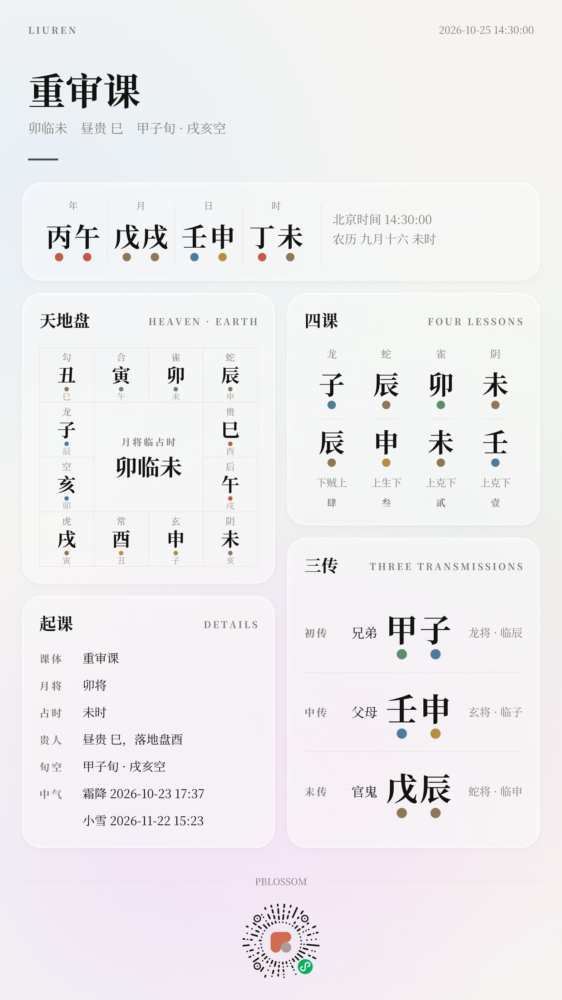</td>
    <td align="center" valign="top">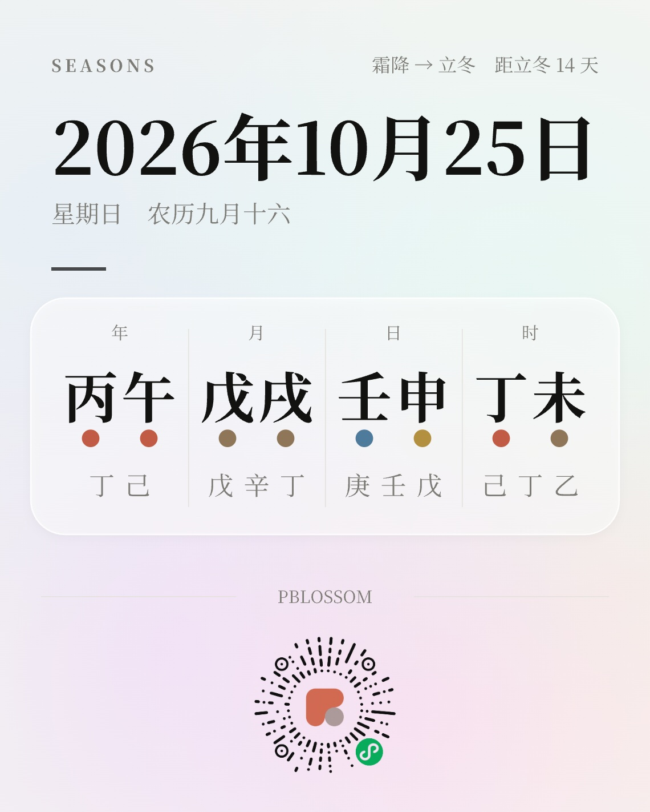</td>
  </tr>
  <tr>
    <td align="center"><strong>梅花</strong></td>
    <td align="center"><strong>六壬</strong></td>
    <td align="center"><strong>时令</strong></td>
  </tr>
</table>
</div>

### 小程序

<div align="center">
<table>
  <tr>
    <td align="center">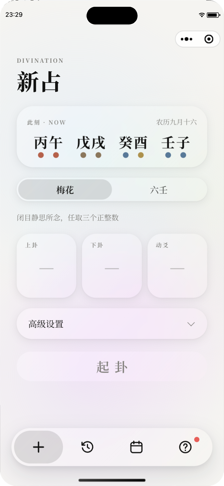</td>
    <td align="center">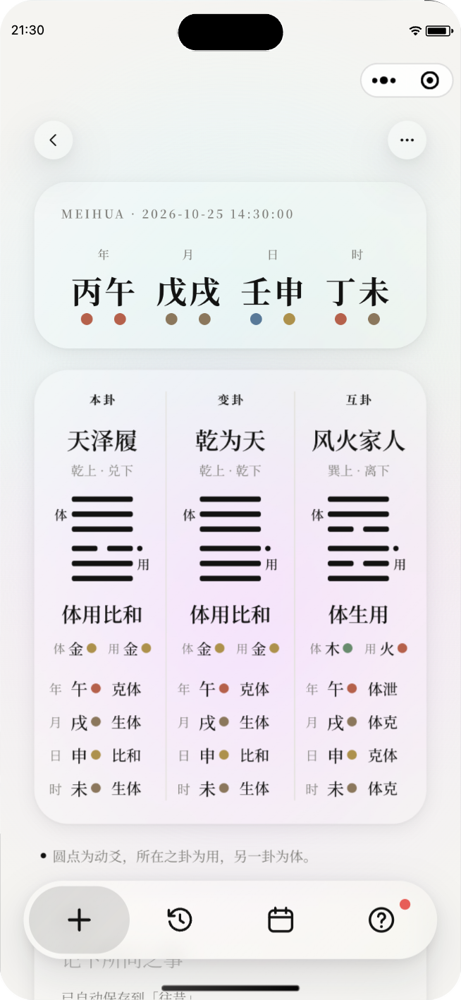</td>
    <td align="center">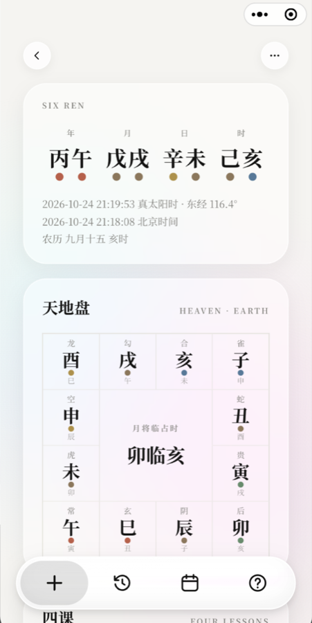</td>
    <td align="center">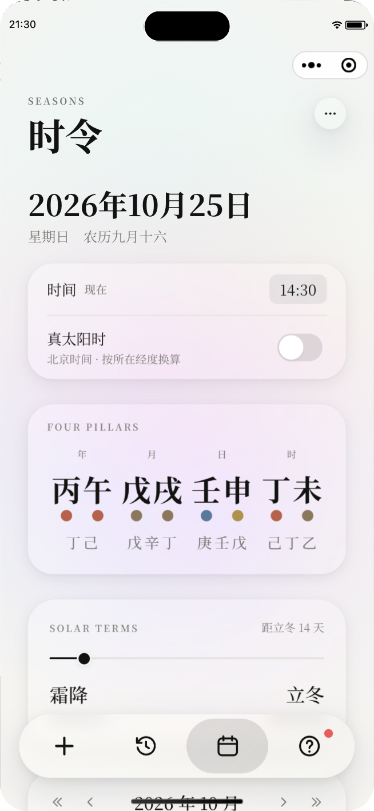</td>
  </tr>
  <tr>
    <td align="center"><strong>新占</strong></td>
    <td align="center"><strong>梅花结果</strong></td>
    <td align="center"><strong>六壬结果</strong></td>
    <td align="center"><strong>时令</strong></td>
  </tr>
</table>
</div>

## 本地运行与开发
网页版是纯静态网页，不需要服务器端程序。在仓库目录里起一个静态服务器即可：

```bash
python3 -m http.server 8000
```

然后打开 http://localhost:8000 。

目录说明：
- `mp/`：由小程序生成的页面逻辑、界面模板和样式，不要手改；小程序更新后运行 `node scripts/sync-miniprogram.mjs <小程序目录>` 重新生成。
- `app/`：网页专有的部分，包括微信接口的浏览器实现、电脑版侧边栏与两栏排版、液态玻璃效果。
- `assets/`、`vendor/`：字体、Logo 和 Vue 3（各自的许可见文末）。

## 名称来源
PBlossom 是 Plum Blossom（梅花）的简写，来源于“梅花易数”。

## Logo设计
Logo 实际上是一个珊瑚橙
<a title="珊瑚橙 #DA7756"></a>
<code>#DA7756</code>
的“P”与灰褐色
<a title="灰褐色 #B1ADA1"></a>
<code>#B1ADA1</code>
的“B”上下重叠在一起，代表着 Plum Blossom（梅花）。
<div align="center">
  
</div>

## 温馨提示
目前市面上最强的 AI 在玄学 / 神秘学领域犯错的几率在 50% 左右。**请勿过分相信 AI 给出的结果！**

## 许可
代码以 [MIT 许可](LICENSE) 开放，可以自由使用、修改和分发，保留版权声明即可。

**PBlossom 这个名字和 Logo 不在许可范围内**：`assets/logo.svg` 及其衍生的图形、配色组合，未经同意不得用于其他项目、产品或宣传，也不得用来让人以为某个版本出自本项目。基于本项目修改发布的版本，请换用自己的名字和标志。

内嵌字体取自思源宋体（Noto Serif SC），按 [SIL Open Font License 1.1](assets/fonts/OFL.txt) 分发；Vue 3 为 MIT 许可；网页开关使用 [Puppertino](https://github.com/codedgar/Puppertino)，按 [MIT 许可](vendor/puppertino/LICENSE) 分发，来源与适配见 [组件说明](vendor/puppertino/README.md)。
